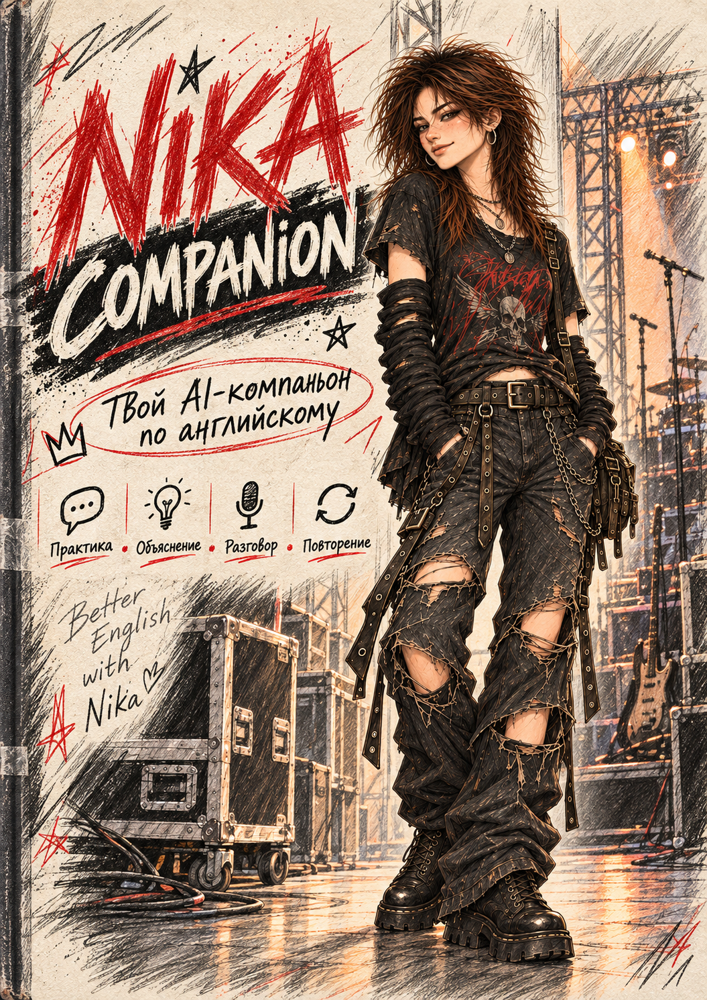
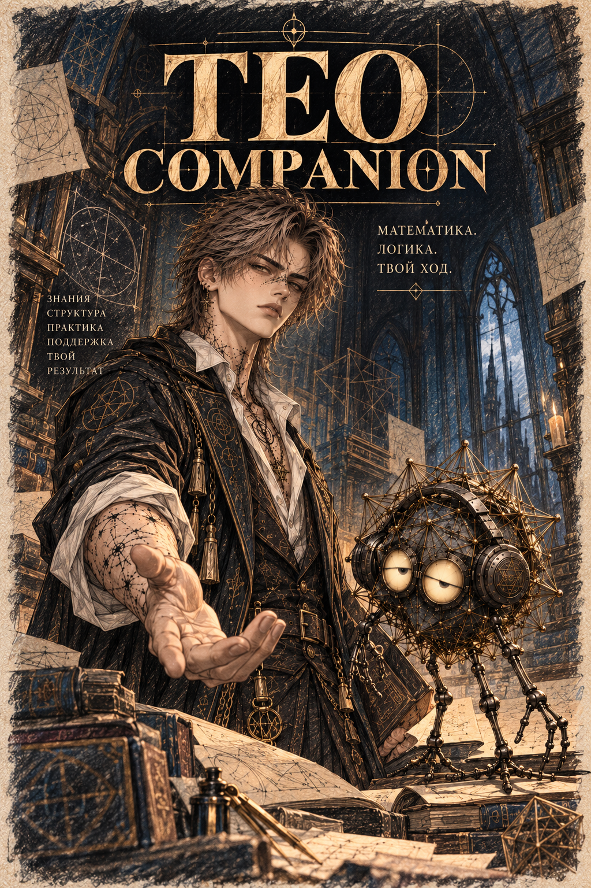

# На одном листе · подарочная коллекция

Один вопрос — уже хорошее начало.

**[Скачать оба издания одним архивом](books/companion-gift-editions.zip)** · [Посмотреть страницы на компьютере и телефоне](books/README.md)

| Ника · English Companion | Тео и Граф · математический компаньон |
| --- | --- |
|  |  |
| **[Открыть PDF Ники](books/english-companion.pdf)** | **[Открыть PDF Тео и Графа](books/math-companion.pdf)** |
| Понимать смысл, замечать закономерность, говорить своим голосом. | Понимать устройство задачи, выбирать метод, проверять результат. |

## Что внутри

Обложка и вступление от персонажа. Понятный первый шаг. Полный готовый промпт. Примеры обращений, управление занятием, сохранение прогресса и возвращение в другой чат. Финальная иллюстрация и завершение.

В математике можно **позвать Графа** или **вернуть Тео**. Меняется голос, а задача, прогресс и требования к точности остаются общими. У Ники — живой английский, естественный перевод и объяснения без стыда за ошибки.

## Как начать

1. Скачай и распакуй ZIP, открой **START.html** в браузере. Либо читай выбранный PDF.
2. В издании нажми **«Скопировать промпт»**, вставь его в новый доступный ИИ-чат и задай один вопрос.
3. Перед уходом попроси сохранить прогресс и забери заметку себе.

Шрифты, иллюстрации и тексты уже в архиве. Для чтения интернет не нужен; для занятия нужен выбранный ИИ-сервис. Если копирование запрещено браузером, рядом есть TXT и полный текст инструкции. Расширенные raw-профили необязательны — краткие характеры уже встроены.

ИИ может ошибаться. Проверяй важное и сохраняй личные учебные заметки у себя. Возможности сервисов отличаются; бесплатный доступ к одному из них не гарантирует чтение ссылок, файлов или аудио.

Читательский макет для авторского просмотра · 25 октября 2026. Промптовая основа 2.0.0-rc.1; живые испытания в ChatGPT/Qwen ещё не заявляются пройденными.

Для автора и сопровождения

[Профили персонажей](profiles/) · [Исходные продукты](originals/README.md) · [Что улучшено](DESIGN.md) · [Обновления и сборка](MAINTAINING.md) · [Технические проверки](tests/REPORT.md) · [Проверки оформления](books/REVIEW.md) · [Происхождение](provenance/README.md).

Техническая навигация сохранена отдельно: [MAINTAINER_INDEX.md](MAINTAINER_INDEX.md). Книги и сайт этим комплектом не публиковались. Публичное чтение не устанавливает отдельную коммерческую лицензию на персонажей и текст.

